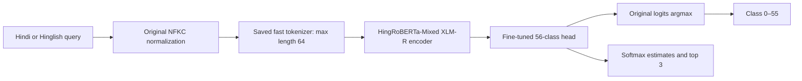

# IntentScope — Multilingual Intent Classification

Anveshan DataSprint 2.0 final demo application. React/TanStack Start and Tailwind provide the dashboard; a separate, genuine **FastAPI Web App** runs the original trained PyTorch/Hugging Face model. There are no LLM APIs, mock predictions, ensembles or retraining steps in this application.

## Current availability

- Included: complete frontend, FastAPI service, original `notebooks/hingrobert_1.ipynb`, all eight recorded epoch metrics, classification report, verification/benchmark/reproduction scripts, Docker deployment, and technical form draft.
- **Reviewed privately:** original training dataset (16,936 rows), test dataset (4,912 rows), original Fold 0 submission (4,912 rows), and the re-uploaded notebook (identical to the preserved notebook). All reference IDs match test IDs and order. Only aggregate statistics and artifact hashes are included in the public repository.
- **Not supplied:** recreated `hingroberta_fold0_best` checkpoint/tokenizer and official intent-name mapping. The original checkpoint is unavailable; its replacement is being recreated by the owner on Kaggle, not retrained by this application.
- Inference stays disconnected until the exact weights and tokenizer are restored. No latency, integer parameter count or hosted demo URL is invented.
- The supplied notebook later also trains `hingroberta_final` on full data. The user confirmed the **Fold 0 checkpoint** is the submitted model; the application does not load the later model. The notebook is retained unchanged as provenance.

## A. Pipeline and architecture



Base checkpoint: `l3cube-pune/hing-roberta-mixed`. Architecture: XLM-RoBERTa sequence classifier. Load exactly one saved fine-tuned model with FP32 stored weights, `model.eval()` and `torch.inference_mode()`. CUDA FP16 autocast matches the notebook; CPU falls back to FP32. Use the original tokenizer saved alongside the Fold 0 model. Dynamic padding rounds to a multiple of eight; max token length is 64. Notebook submission inference batch size is 16.

The exact normalization copied from the notebook is:

```python
import re, unicodedata

def norm(t):
    t = unicodedata.normalize("NFKC", str(t)).lower()
    t = t.replace("\u093c", "").replace("\u0901", "\u0902")
    t = re.sub(r"([a-z])\1{2,}", r"\1\1", t)
    t = re.sub(r"[^\w\s\u0900-\u097F]", " ", t)
    return re.sub(r"\s+", " ", t).strip()
```

The pipeline contains no translation, language-dependent prediction override, confidence cutoff or bias adjustment. APIs reject empty/invalid inputs rather than fabricating a result. Only generic `Intent N` names are used without an official mapping; Class 55 has its specified OOS label.

### Training provenance (no retraining in this app)

16,936 queries; `StratifiedKFold(n_splits=5, shuffle=True, random_state=42)`, with only Fold 0 used for the confirmed submission. Train: 13,548; validation: 3,388. Eight epochs; best epoch 8. Batch size 8, gradient accumulation 2, effective batch 16. Encoder LR 3e-5, head LR 1e-3, label smoothing .05, weight decay .01, warm-up ratio .10. AdamW with linear schedule, FP32 weights/CUDA AMP, gradient clipping 1.0. The notebook computes class weights in a separate cell but its recorded training loss uses ordinary label-smoothed cross entropy; do not claim class weighting in the final loss.

## B. Cross-script and Class 55 handling

HingRoBERTa-Mixed’s Hindi–English code-mixed pretraining supports contextual representation of Devanagari Hindi, Romanized Hindi and Hinglish. The comparison page independently infers both inputs; identical meaning does **not** guarantee identical classes. Latin script detection describes observed characters, not inferred language.

Class 55 is one of the 56 learned classes. `logits.argmax(axis=1)` chooses it normally when its logit is largest. The amber OOS visualization only describes the actual result. Softmax is a probability estimate, not guaranteed correctness. No threshold optimization, manual rules, ensembling or bias tuning is included.

Macro-F1 gives each class equal weight. It prevents frequent categories from dominating evaluation and is therefore useful for this imbalanced intent dataset.

## C. Parameter count proof

The notebook reports **278.09M rounded**, not an exact integer. The exact count and compliance proof must be generated after restoring weights:

```python
total_parameters = sum(p.numel() for p in model.parameters())
trainable_parameters = sum(p.numel() for p in model.parameters() if p.requires_grad)
assert total_parameters <= 300_000_000
print(total_parameters, trainable_parameters)
```

```sh
python scripts/verify_model.py
```

**Measured integer output: PENDING — saved checkpoint not supplied.** The script reports total/trainable counts, device, hardware, loaded checkpoint and compliance; failure stops execution. The HTTP service checks before readiness/inference. Remaining allowance is `300_000_000 - total_parameters`. There is no unsupported claim of measured compliance. The loader rejects missing, unexpected, mismatched or newly initialized weights and never downloads an untrained fallback.

## D. Validation results and limitations

| Epoch | Training loss | Validation Macro-F1 | Validation accuracy |
|---|---:|---:|---:|
| 1 | 1.99407 | 0.72849 | 0.77686 |
| 2 | 1.04138 | 0.79211 | 0.83117 |
| 3 | 0.77977 | 0.82810 | 0.84976 |
| 4 | 0.63576 | 0.83869 | 0.85744 |
| 5 | 0.54323 | 0.84576 | 0.86275 |
| 6 | 0.48130 | 0.84960 | 0.86777 |
| 7 | 0.44588 | 0.85458 | 0.87072 |
| 8 | 0.42676 | **0.85716** | **0.87367** |

Leaderboard Macro-F1: **0.8196**, supplied in the project brief (not measured by this app). Previous XLM-R Fold 0 Macro-F1: 0.83370; recorded improvement: **+0.02346** (2.346 percentage points). Do not claim this is the biggest improvement across experiments that were not supplied. A classification report with all 56 class F1 scores and validation support is included in `backend/metrics.json` and displayed in the dashboard. No confusion matrix was recorded. Full-training class counts are now computed from the uploaded training dataset, separately from validation support; no missing evaluation values are fabricated.

### Actual dataset analysis and privacy

The performance page shows all 56 training class counts and the original reference prediction distribution. Training has 249 Class 55 labels; the reference submission has 335 Class 55 predictions (6.82%). Reference predictions are **not test ground truth** and cannot establish accuracy. Training contains 10,353 Devanagari-only, 5,645 Latin-only and 938 mixed-script queries; test contains 1,604, 3,154 and 154 respectively. Script categories describe characters, not inferred language. Original normalization yields 14 duplicate training queries, no duplicate test queries, and no empty normalized queries; no rows are removed or rewritten.

Keep competition CSVs outside the repository and any web-served directory. They have not been copied into this project. Regenerate public aggregate snapshots from private files:

```sh
python scripts/analyze_datasets.py --train /private/train.csv --test /private/test.csv --reference /private/hingroberta_fold0_submission.csv --notebook notebooks/hingrobert_1.ipynb
cp backend/dataset_stats.json src/data/dataset_stats.json
```

On Windows use `Copy-Item backend/dataset_stats.json src/data/dataset_stats.json`. This script uses only the Python standard library and existing normalization, exports counts and SHA-256 provenance only, and does not require a checkpoint. The API and dashboard snapshots must remain identical. The private-analysis row count does not change the public API's 10,000-row upload limit. Do not publish the raw datasets or original submission without the owner's permission.

This is **single Fold 0 validation**, not completed five-fold OOF. Bias tuning was tested separately and excluded from the final submission because leaderboard performance decreased, according to the brief. The app never applies it. Any broader claims of generalization require more evidence.

## E. Submission reproduction

1. Install Python 3.13, create a virtual environment, and install `requirements.txt`.
2. Obtain the owner's recreated `hingroberta_fold0.zip`. Extract it and locate the saved `hingroberta_fold0_best` directory including tokenizer files. An `.ipynb` alone cannot restore trained weights. A recreated checkpoint is not automatically equivalent to the unavailable original.
3. Place files under `model/hingroberta_fold0_best/`, or set `MODEL_PATH` to their directory. Do not rename the later full-data checkpoint to pretend it is Fold 0.
4. Use the original competition `test.csv` and Fold 0 reference submission already supplied by the owner. Keep them at private paths outside the public repository.
5. Run model verification, then reproduction using original normalization, max length 64, dynamic padding and batch size 16:

```sh
python scripts/verify_model.py
python scripts/reproduce_submission.py --test /private/test.csv --reference /private/hingroberta_fold0_submission.csv --output /private/regenerated_submission.csv --report /private/reproduction_report.json
```

6. The output has **exactly `example_id,target`**, preserves IDs (including leading zeroes), and preserves dataset order. The script compares all IDs and targets row by row and exits nonzero on mismatches.
7. The JSON report records ID/order mismatches, target mismatches, row counts, input/output SHA-256 hashes, inference mode and loaded model metadata. Exact original reference/test ID alignment is verified, but **prediction reproduction is pending the recreated checkpoint**. Even with identical training configuration, recreation may change predictions. A mismatch exits nonzero; investigate without bias tuning or changing the model. Floating-point behavior, hardware and Transformers/PyTorch versions can affect edge predictions; retain the notebook runtime versions.

To audit an existing regenerated CSV without loading weights, add `--compare-only /private/regenerated_submission.csv` and `--report /private/comparison_report.json`. Such a report is labeled `comparison_only`, has no loaded model proof and is **not evidence of executed inference**. Reference and candidate IDs must both match the test order, and every target must match the original reference. Missing/duplicate IDs, invalid targets and incorrect columns are rejected.

The API batch uploader accepts a CSV file in the browser, validates it, then sends the CSV content as JSON `{ "csv_text": "..." }`. Requests are processed with notebook batch size 16. The frontend submits chunks and reports actual completed-row progress. Batched average processing latency is not the single-query benchmark.

## Local setup — Windows / VS Code

Install Python 3.13 and Bun. Open the repository folder in VS Code, then its PowerShell terminal:

```powershell
py -3.13 -m venv .venv
.venv\Scripts\Activate.ps1
python -m pip install -r requirements.txt
bun install
python scripts/verify_model.py
python scripts/start_local.py
```

If PowerShell activation is blocked, use `.venv\Scripts\python.exe` directly. Linux/macOS: `python3 -m venv .venv && source .venv/bin/activate`. The pinned Transformers 4.57.6 matches the notebook’s installation cell; PyTorch 2.11.0 and NumPy 2.1.3 match the recorded notebook runtime. Its Python was 3.13.16 and its CUDA PyTorch build was 2.11.0+cu130; retain that CUDA build on compatible GPU hardware for strict reproduction. For a CUDA-specific PyTorch wheel, follow the official PyTorch installer for the host’s CUDA version without changing the inference algorithm.

The launcher starts one Uvicorn worker on port 8000 and the frontend on port 8080. Stop with Ctrl+C. Model loading is once at service startup, never once per query. To run separately:

```sh
python -m uvicorn backend.main:app --host 0.0.0.0 --port 8000 --workers 1
bun run dev
```

Open **http://localhost:8080**. Click Connection settings and enter **http://localhost:8000**, or configure public `VITE_INFERENCE_API_URL` before launching. Swagger is at **http://localhost:8000/docs**. Never place secrets in `VITE_` settings. Theme and API address are local interface preferences; no predictions are fabricated or stored as a model fallback.

## Benchmarking

```sh
python scripts/benchmark.py --queries test.csv --count 100 --output benchmark_report.json
```

The dashboard offers the same measurement: one already-loaded model, five warm-ups, at least 100 measured runs, batch size 1, `time.perf_counter()`, CUDA synchronization before/after each run. Timing includes original normalization, tokenization, model forward, device transfers and prediction extraction. Loading time is excluded. Average, median and interpolated p95 are reported, together with raw timings, query count, device/hardware, warm-ups and checkpoint. The supplied query pool cycles if fewer than 100 queries are provided; repeated runs are not represented as unique queries. Report downloads use measured values only.

**Average inference latency: PENDING actual hardware execution.** Neither the demo nor this README estimates it.

## REST endpoints

| Method | Endpoint | Contract |
|---|---|---|
| GET | /api/health | readiness, detail, optional loaded model metadata |
| POST | /api/predict | JSON: `{"query":"..."}` |
| POST | /api/batch-predict | JSON: `{"csv_text":"example_id,query_text\n..."}` |
| POST | /api/benchmark | JSON: `{"queries":["..."],"count":100}` (100–1000) |
| GET | /api/model-info | exact total/trainable parameters, device, checkpoint |
| GET | /api/metrics | notebook-recorded evaluation metrics |
| GET | /api/dataset-stats | aggregate-only training, test, reference counts and artifact hashes |
| GET | /docs | Swagger UI |

Single prediction returns class ID, probability, top three, latency, detected script, original/normalized text and unpadded token count. Input up to 10,000 characters is normalized and tokenized with truncation to 64 tokens. CSV limits: 10 MB input and 10,000 rows per file. Service handles missing files, malformed CSV, empty normalized text, API errors and insufficient memory. Readiness remains false on load failure; missing weights never silently initialize a classifier.

## Deployment and live demo

This Lovable frontend runs on TanStack Start. PyTorch is deployed **separately** on a Python/Docker host, not inside Lovable’s web runtime. No Lovable Cloud database is needed for this public inference-only application.

### Hugging Face Docker Spaces

1. Create a Docker Space and copy Dockerfile, requirements, backend, scripts and model directory.
2. Upload exact weights using Git LFS or attach persistent storage/private model storage. Keep model downloads or mounts as a **startup/deployment** step, never a per-query download. This app has no automatic downloads.
3. Select CPU with sufficient RAM (recommend at least 4–8 GB; weights alone use about 1.1 GB at FP32) or suitable GPU hardware. Hosting costs depend on the provider.
4. Set `MODEL_PATH` and `CORS_ORIGINS` to actual frontend origins (comma-separated). Use HTTPS; local HTTP cannot be called from a publicly hosted HTTPS page.
5. Deploy one Uvicorn worker on port 7860. Verify `/api/health` reports ready, then connect `https://your-space.hf.space` in the frontend. Set `VITE_INFERENCE_API_URL` for the deployed frontend when configuring its environment.
6. Publish the frontend separately and add its published URL to the CORS list. This repository is not itself proof of a live hosted deployment.

```sh
docker build -t intentscope-api .
docker run --rm -p 7860:7860 -e CORS_ORIGINS=https://your-frontend-host -v /absolute/model/path:/app/model:ro intentscope-api
```

Use `.env.example` as a configuration reference; set environment variables on the Python host or shell explicitly (the backend does not implicitly load a dotenv file). The mounted model folder must contain `hingroberta_fold0_best/`, or override `MODEL_PATH`.

For a public judge demo, use an origin allowlist and host-level rate limits/concurrency controls to prevent compute abuse. CORS is not authentication. Do not expose confidential data in a public service. A single model lock serializes inference and prevents benchmark interference but is not a deployment rate limiter.

### Local screen-share fallback

Restore weights and dependencies before judging. Start the application with `python scripts/start_local.py`; open the playground, verify connected state, run one Hindi and one Hinglish query, compare scripts, upload CSV, and run/download the benchmark. Keep the model loaded before timing. Internet is not needed for inference with complete local checkpoint/tokenizer files.

**Hosted demo URL: PENDING deployment.**

## Repository structure

```text
src/             React frontend, TanStack content routes, shared dashboard views
backend/         FastAPI service, inference engine, CSV validation, real metrics
model/           setup instructions; excluded large checkpoint files
notebooks/       unchanged original training notebook
scripts/         verification, benchmark, reproduction and local launcher
docs/            competition setup guidance
public/docs/     downloadable documentation rendered by the app
requirements.txt pinned Python deployment dependencies
Dockerfile       independent Python service deployment
TECHNICAL_SUBMISSION.md form answer draft
```

The frontend remains in the template’s standard `src/` layout, rather than introducing a conflicting nested frontend framework. Competition datasets and the original submission remain outside this public repository; `backend/dataset_stats.json` and `src/data/dataset_stats.json` are aggregate-only derived artifacts. Do not upload private CSVs to GitHub or public hosting.

## Tests

```sh
bunx vitest run src/test/intentscope.test.ts src/test/app-routing.test.tsx
python -m unittest discover -s backend/tests -v
```

Tests check parameter-limit boundaries, class labels, submission column/order/ID preservation, exact normalization equivalence to the uploaded notebook, malformed CSV handling, unavailable model behavior, CORS, actual aggregate totals, private-analysis export safety, and strict reference comparison. Actual trained inference, exact loaded parameter count, latency and checkpoint reproduction are **not verified without checkpoint files**.
